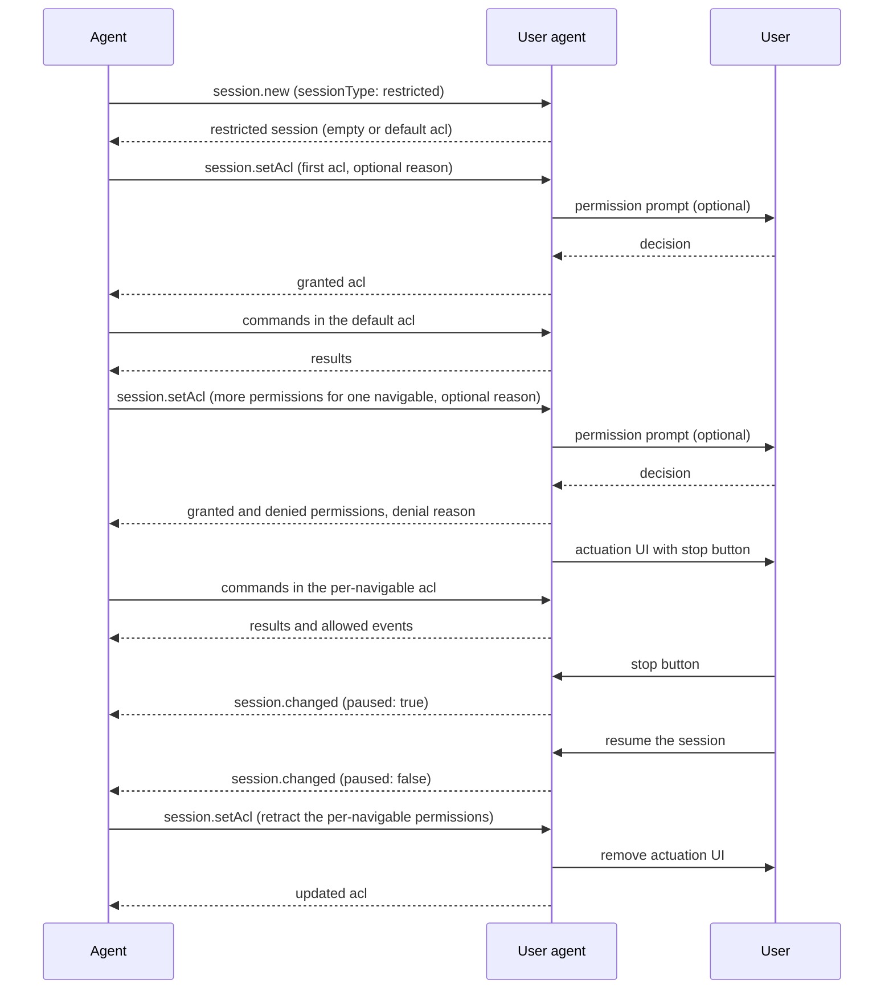

# Agentic extensions for WebDriver BiDi

## Authors

- Alex Rudenko (Google)
- Maksim Sadym (Google)

## Participate

- [Issue tracker](https://github.com/WICG/agentic-webdriver-bidi/issues)
- [Original proposal and discussion](https://github.com/WICG/proposals/issues/320)

## Table of contents

- [Introduction](#introduction)
- [Goals](#goals)
- [Non-goals](#non-goals)
- [Use cases](#use-cases)
- [Proposed solution](#proposed-solution)
  - [Terminology](#terminology)
  - [The access control list](#the-access-control-list)
  - [`session.new`](#sessionnew)
  - [`session.setAcl`](#sessionsetacl)
  - [`session.changed`](#sessionchanged)
  - [Commands and events in a restricted session](#commands-and-events-in-a-restricted-session)
  - [Actuation UI](#actuation-ui)
- [Example: a full session](#example-a-full-session)
- [How this solution addresses the use cases](#how-this-solution-addresses-the-use-cases)
- [Detailed design discussion](#detailed-design-discussion)
- [Transports](#transports)
  - [`browser.driver.connect()`](#browserdriverconnect)
  - [`browser.driver.getNavigableId(tabId)`](#browserdrivergetnavigableidtabid)
  - [`browser.driver.getTabId(navigableId)`](#browserdrivergettabidnavigableid)
- [Roadmap](#roadmap)
- [Considered alternatives](#considered-alternatives)
- [Security and privacy considerations](#security-and-privacy-considerations)
- [Stakeholder feedback](#stakeholder-feedback)
- [References and acknowledgements](#references-and-acknowledgements)

## Introduction

[WebDriver BiDi](https://www.w3.org/TR/webdriver-bidi/) is a browser automation protocol. Its primary purpose is automated browser testing. The protocol assumes complete trust between the client and the browser. A client gets full access to the browser instance and can do destructive actions without security checks.

AI agents also need browser automation. Many agents use low-level protocols or test setups that give unrestricted access without user supervision.

We propose extensions to WebDriver BiDi for agentic use cases that include agentic browsing. A WebDriver BiDi session represents one long-running agentic activity in the browser. Permissions are properties of that session. The user agent enforces the permissions. The user keeps supervision and control of the agent.

A client starts a restricted session with `sessionType: "restricted"` in `session.new`. A restricted session starts with no permissions beyond any user-agent defaults. The agent requests permissions and learns the effective ACL with `session.setAcl`.

An access control list (ACL) contains the permissions of a restricted session. The ACL contains three types of permissions:

- **Origins**: the origins that the agent can access.
- **Commands**: the WebDriver BiDi commands that the agent can send.
- **Events**: the WebDriver BiDi events that the agent can receive.

The ACL also tells the user agent which navigables the agent actuates. A navigable is actuated while its per-navigable permissions contain an actuation command, for example a click or a navigation. The user agent can show actuation UI for that navigable, and the user can stop the agent.

> [!NOTE]
> This proposal is in incubation. All names and data shapes in this document are illustrative and can change. The goal is to move the final features into the WebDriver BiDi specification.

## Goals

1. Let the user supervise and control agent actions in the browser.
2. Keep the agent informed about user decisions.
3. Make the permission mechanism a part of the protocol, so that it is interoperable between browsers.
4. Adapt existing WebDriver BiDi commands and add new commands for agentic use cases.

## Non-goals

1. Testing-specific and debugging-specific features. Standard WebDriver BiDi sessions continue to serve these use cases.
2. A definition of the browser UI for permission prompts. Each user agent selects how it shows permissions to the user.
3. Restrictions on high-level user intent. For example, the protocol cannot know that the user does not want the agent to delete an account.

## Use cases

1. A restricted session can use only the operations that the user or the user agent allowed.
2. The user interrupts an active session. The agent receives a notification and adapts.
3. The user revokes a permission or pauses the session. The session loses the related capabilities immediately, but the connection stays open.
4. The agent requests more capabilities during a session. The user or the user agent makes the decision, and the agent receives the result.
5. The user sees which navigables the agent can actuate. The agent can observe a navigable without actuation UI, for example to read the page in a tab that the user opened.
6. The user stops the agent with one action, for example a stop button. The agent receives a notification.

The [original proposal](https://github.com/WICG/proposals/issues/320) contains more use cases: structured page content, feedback on input, and access to user profile data. They are in scope. See the [roadmap](#roadmap).

## Proposed solution

### Terminology

- **User agent**: the browser.
- **Agent**: the WebDriver BiDi client controlled by an AI system.
- **Restricted session**: a WebDriver BiDi session with `sessionType: "restricted"`. The user agent allows only the operations in the ACL of the session.
- **Access control list (ACL)**: a dictionary that contains the allowed origins, commands, and events for a restricted session.
- **Actuation command**: a command that changes the state of a navigable or acts for the user, for example a click, a key press, or a navigation. See [actuation UI](#actuation-ui).
- **Actuated navigable**: a navigable whose `perNavigable` entry in the effective ACL contains at least one actuation command.

### The access control list

The ACL has two parts:

- `default` contains the permissions of the full session, for all navigables.
- `perNavigable` contains more permissions for specific navigables. Each entry extends the `default` configuration. It does not replace it.

Each part contains three lists:

- `origins`: the origins that the agent can access.
- `commands`: the names of the commands that the agent can send.
- `events`: the names of the events that the agent can receive.

The `commands` and `events` lists can contain only the names in [Commands and events in a restricted session](#commands-and-events-in-a-restricted-session).

```js
{
  default: {
    origins: [...originURL],
    commands: [...commandName],
    events: [...eventName]
  },
  perNavigable: {
    "<navigable id>": {
      origins: [...originURL],
      commands: [...commandName],
      events: [...eventName]
    }
  }
}
```

The user agent enforces the ACL:

- A command fails if the ACL does not contain the command for the target navigable.
- A command fails if the ACL does not contain the origin of the target document.
- The user agent does not send an event if the ACL does not contain the event for the source navigable.

User agents may restrict some commands and events to be valid only in a `perNavigable` entry. It is recommended that actuation commands are valid only in a `perNavigable` entry, because they are the signal for [actuation UI](#actuation-ui).

The ACL does not control these commands and events. They are always available in a restricted session:

- `session.status`
- `session.end`
- `session.setAcl`
- `session.changed`

### `session.new`

A client includes `sessionType: "restricted"` in the capabilities of `session.new` to start a restricted session. The result confirms the session type.

`session.new` does not accept an ACL. A restricted session starts with an empty ACL (or only user-agent-default permissions). The agent sends [`session.setAcl`](#sessionsetacl) to request permissions and receive the effective ACL before using other commands or receiving other events.

User agents must not rely solely on the client passing `sessionType: "restricted"` in `session.new` to enforce restrictions, because a client could omit it and obtain a standard (unrestricted) session. Agent-facing transports and endpoints should allow only restricted sessions (for example, the [extension transport](#browserdriverconnect)).

Request:

```json
{
  "id": 1,
  "method": "session.new",
  "params": {
    "capabilities": {
      "alwaysMatch": {
        "sessionType": "restricted"
      }
    }
  }
}
```

Response:

```json
{
  "id": 1,
  "type": "success",
  "result": {
    "sessionId": "3f1c6a52-9f0e-4a57-8a0b-6d1e2c7b9a10",
    "capabilities": {
      "sessionType": "restricted"
    }
  }
}
```

### `session.setAcl`

The agent sends `session.setAcl` to change the ACL of the session. This command is the only method to get permissions. There are two uses:

- **Request permissions.** The agent can provide a `reason`. The user or the user agent can grant or deny the request.
- **Retract permissions.** For example, the agent removes the permissions for a navigable after it completes an interaction.

The command accepts two parameters:

- `acl`: the full ACL that the agent requests for the session.
- `reason`: an optional text from the agent that explains the request. The user agent may deny a permission request without a `reason`.

The result contains two fields:

- `acl`: the effective ACL of the session after the change. It can be smaller than the requested ACL (if permissions were denied) or larger (if the user agent grants default permissions). User-agent-default permissions remain in the effective ACL even if omitted from a subsequent `session.setAcl` call.
- `denied`: the permissions that the user agent denied. The user agent omits this field if it granted the full request.

The `denied` field contains two fields:

- `acl`: the denied origins, commands, and events, in the ACL format.
- `reason`: an optional text from the user agent that explains the denial. The agent can use it to select a different approach.

We expect agents to request permissions only when necessary, and to retract them after use. This is especially important for actuation commands, because they control the [actuation UI](#actuation-ui).

#### Ordering of concurrent calls

`session.setAcl` carries the full ACL and may wait on a user prompt. Without ordering, out-of-order prompts lose updates, `denied` is computed against a moving base, and a pending request can undo a revocation.

- The user agent queues only `session.setAcl` calls and processes them strictly one after another, in arrival order. Other commands are not queued and continue to run against the current effective ACL while a `session.setAcl` call is pending.
- A queued `session.setAcl` call is evaluated against the effective ACL at the time it runs, after any revocation by the user. A revoked entry that the request still contains counts as a new request (the user agent prompts again or denies it) and is never silently restored.
- If the agent sends a second `session.setAcl` call before it sees the first result, the second call's full ACL wins. Avoiding this race is the client's responsibility.

#### Example: first request

The agent requests its first permissions after `session.new`.

Request:

```json
{
  "id": 2,
  "method": "session.setAcl",
  "params": {
    "acl": {
      "default": {
        "origins": ["https://shop.example"],
        "commands": [
          "browsingContext.getTree",
          "browsingContext.captureScreenshot"
        ],
        "events": ["browsingContext.navigationCommitted"]
      }
    },
    "reason": "Find the item that the user asked for on shop.example."
  }
}
```

Response. The user agent grants the full request:

```json
{
  "id": 2,
  "type": "success",
  "result": {
    "acl": {
      "default": {
        "origins": ["https://shop.example"],
        "commands": [
          "browsingContext.getTree",
          "browsingContext.captureScreenshot"
        ],
        "events": ["browsingContext.navigationCommitted"]
      },
      "perNavigable": {}
    }
  }
}
```

#### Example: more permissions for one navigable

The agent requests more permissions for navigable `A1B2C3`.

Request:

```json
{
  "id": 3,
  "method": "session.setAcl",
  "params": {
    "acl": {
      "default": {
        "origins": ["https://shop.example"],
        "commands": [
          "browsingContext.getTree",
          "browsingContext.captureScreenshot"
        ],
        "events": ["browsingContext.navigationCommitted"]
      },
      "perNavigable": {
        "A1B2C3": {
          "origins": ["https://shop.example", "https://pay.example"],
          "commands": ["browsingContext.navigate", "input.performActions", "script.evaluate"],
          "events": ["browsingContext.userPromptOpened", "log.entryAdded"]
        }
      }
    },
    "reason": "Add the selected item to the cart and open the checkout page."
  }
}
```

Response. In this example, the user agent denies `script.evaluate`, `log.entryAdded`, and the `https://pay.example` origin, and it gives a reason:

```json
{
  "id": 3,
  "type": "success",
  "result": {
    "acl": {
      "default": {
        "origins": ["https://shop.example"],
        "commands": [
          "browsingContext.getTree",
          "browsingContext.captureScreenshot"
        ],
        "events": ["browsingContext.navigationCommitted"]
      },
      "perNavigable": {
        "A1B2C3": {
          "origins": ["https://shop.example"],
          "commands": ["browsingContext.navigate", "input.performActions"],
          "events": ["browsingContext.userPromptOpened"]
        }
      }
    },
    "denied": {
      "acl": {
        "perNavigable": {
          "A1B2C3": {
            "origins": ["https://pay.example"],
            "commands": ["script.evaluate"],
            "events": ["log.entryAdded"]
          }
        }
      },
      "reason": "The user did not allow access to payment pages. A policy does not allow script evaluation and console messages."
    }
  }
}
```

### `session.changed`

The user agent sends this event when the user or the user agent changes the session. There are two causes:

- The user pauses or resumes the session. For example, the user clicks the stop button in the [actuation UI](#actuation-ui).
- The user changes the permissions. For example, the user revokes access to a navigable.

The event has three fields:

- `acl`: the updated ACL.
- `paused`: `true` if the user or the user agent paused the session.
- `reason`: an optional text from the user agent that explains the change, for example why it revoked a permission.

While the session is in the paused state, the agent must expect commands to fail. The connection stays open.

The user agent always sends `session.changed` to a restricted session. The ACL does not control this event.

In this example, the user pauses the session and revokes the permissions for navigable `A1B2C3`:

```json
{
  "type": "event",
  "method": "session.changed",
  "params": {
    "paused": true,
    "reason": "The user paused the session and revoked access to the tab.",
    "acl": {
      "default": {
        "origins": ["https://shop.example"],
        "commands": [
          "browsingContext.getTree",
          "browsingContext.captureScreenshot"
        ],
        "events": ["browsingContext.navigationCommitted"]
      },
      "perNavigable": {}
    }
  }
}
```

### Commands and events in a restricted session

A restricted session supports only the commands and events in this section. The user agent rejects all other commands. The `commands` and `events` lists of an ACL can contain only the navigable commands and events below; session commands and events are always available and not controlled by the ACL.

Most of these commands and events are existing WebDriver BiDi commands and events. This proposal adds `session.setAcl` and `session.changed`. It also extends some existing commands, as the tables show.

Session commands and events:

| Name | Type | Status | Description |
| :--- | :--- | :--- | :--- |
| [`session.new`](#sessionnew) | Command | Existing, extended | Starts a restricted session if the capabilities contain `sessionType: "restricted"`. |
| `session.status` | Command | Existing | Returns whether the user agent is ready to create a new session. |
| `session.end` | Command | Existing | Ends the current session. |
| `session.subscribe` | Command | Existing | Subscribes to any events. The user agent emits only events allowed by the ACL. |
| `session.unsubscribe` | Command | Existing | Unsubscribes from events. |
| [`session.setAcl`](#sessionsetacl) | Command | New | Requests or retracts permissions. The parameters are `acl` and an optional `reason`. The result contains the granted and denied permissions. |
| [`session.changed`](#sessionchanged) | Event | New | Tells the agent that the user or the user agent paused, resumed, or reconfigured the session. The fields include `acl` and `paused`. |

Commands and events that observe navigables:

| Name | Type | Status | Description |
| :--- | :--- | :--- | :--- |
| `browsingContext.getTree` | Command | Existing | Returns the tree of navigables whose origins are allowed by the ACL. Navigables with disallowed origins are omitted. |
| `browsingContext.captureScreenshot` | Command | Existing | Returns a screenshot of a navigable. The user agent redacts the screenshot in accordance with the origin permissions. |
| `browsingContext.locateNodes` | Command | Existing, extended | Finds DOM elements by locator. The extension adds a locator for an `x`, `y` position and returns serialized accessibility data. |
| `log.entryAdded` | Event | Existing | Contains a console message or uncaught JavaScript error from a navigable, if allowed by the user agent. |
| `browsingContext.userPromptOpened` | Event | Existing | Tells the agent that a navigable opened a JavaScript dialog. |
| `browsingContext.navigationCommitted` | Event | Existing | Tells the agent that a navigable navigated. The event contains the new URL. |
| `browsingContext.fragmentNavigated` | Event | Existing | Tells the agent that a navigable navigated to a fragment URL. |
| `browsingContext.historyUpdated` | Event | Existing | Tells the agent that a navigable updated its history entry (for example via `history.pushState`). |
| `browsingContext.userPromptClosed` | Event | Existing | Tells the agent that a JavaScript dialog in a navigable closed. |
| `browsingContext.contextCreated` | Event | Existing | Tells the agent that a navigable was created. |
| `browsingContext.contextDestroyed` | Event | Existing | Tells the agent that a navigable was destroyed. |

Commands that change navigables:

| Name | Type | Status | Description |
| :--- | :--- | :--- | :--- |
| `browsingContext.create` | Command | Existing | Creates a navigable. This command is not an actuation command, because the agent cannot actuate the new navigable without explicit permission. |
| `browsingContext.close` | Command | Existing | Closes a navigable. |
| `browsingContext.navigate` | Command | Existing | Navigates a navigable. |
| `browsingContext.reload` | Command | Existing | Reloads a navigable. |
| `browsingContext.traverseHistory` | Command | Existing | Moves a navigable backward or forward in its session history. |
| `browsingContext.handleUserPrompt` | Command | Existing | Accepts or dismisses a JavaScript dialog in a navigable. |
| `input.performActions` | Command | Existing, extension planned | Sends trusted keyboard, pointer, and wheel actions to a navigable. |
| `input.releaseActions` | Command | Existing | Releases all keys and pointer buttons that are in the pressed state in a navigable. |
| `script.callFunction` | Command | Existing, restricted | Calls a function in a navigable (for example with `sharedId` node references from `browsingContext.locateNodes`). `target` must specify a browsing context and a non-empty `sandbox`. Awaits promises when `awaitPromise` is `true` and returns a serialized result (`script.RemoteValue`). |
| `script.evaluate` | Command | Existing, restricted | Evaluates script in a navigable. `target` must specify a browsing context and a non-empty `sandbox`. Awaits promises when `awaitPromise` is `true` and returns a serialized result (`script.RemoteValue`). |

`input.performActions` does not tell the agent the result of an action ([#5](https://github.com/WICG/agentic-webdriver-bidi/issues/5)). The agent needs this feedback:

- The position of a click and the element that the click hit.
- The distance of a scroll and the position of the viewport on the page after the scroll.
- The text that an input field received.

We must extend `input.performActions` to return this feedback in the command result or as an event, or add new commands that return this data.

### Actuation UI

User agents are encouraged to show dedicated UI while an agent actuates a navigable ([#6](https://github.com/WICG/agentic-webdriver-bidi/issues/6)). For example, the user agent can:

- Show that the agent controls the navigable.
- Show other UI that helps the user follow the agent, for example click visualization.
- Show a control, for example a stop button, that lets the user stop the agent.

The ACL is the signal for this UI. A navigable is an actuated navigable while its `perNavigable` entry in the effective ACL contains at least one actuation command. Thus:

- The actuation starts when `session.setAcl` grants an actuation command for the navigable.
- The actuation ends when the effective ACL no longer contains an actuation command for the navigable. This occurs when the agent retracts the permissions with `session.setAcl`, or when the user or the user agent revokes them. It also occurs when the navigable closes or the session ends.

The actuation continues across navigations in the navigable, and across commands that are not actuation commands. The agent can request permissions for more than one navigable at the same time. Each of these navigables is an actuated navigable.

Actuation commands are valid only in a `perNavigable` entry. If an agent requests an actuation command in the `default` part of the ACL, the user agent denies it. Thus the user agent always knows which navigables the agent can actuate.

The actuation commands include:

- `browsingContext.handleUserPrompt`
- `browsingContext.navigate`
- `browsingContext.reload`
- `browsingContext.traverseHistory`
- `input.performActions`
- `input.releaseActions`
- `script.callFunction`
- `script.evaluate`

`script.callFunction` and `script.evaluate` are actuation commands because script can click elements and change the page. See the [open questions](#open-questions) for read-only script evaluation.

An agent that only observes a navigable does not cause actuation UI. For example, a `perNavigable` entry with only `browsingContext.captureScreenshot` does not make the navigable an actuated navigable.

When the user clicks the stop button, the user agent pauses the session and sends [`session.changed`](#sessionchanged) with `paused: true`. The user agent can also revoke the actuation commands from the ACL.

The agent must retract the actuation commands for a navigable when it completes the actuation. Otherwise the user agent continues to show the actuation UI. The protocol cannot enforce this. The user agent can revoke permissions at any time, for example after a period of inactivity, and send `session.changed`.

In this example, the agent completes its task on navigable `A1B2C3`. It retracts the `perNavigable` entry, and the user agent removes the actuation UI:

```json
{
  "id": 6,
  "method": "session.setAcl",
  "params": {
    "acl": {
      "default": {
        "origins": ["https://shop.example"],
        "commands": [
          "browsingContext.getTree",
          "browsingContext.captureScreenshot"
        ],
        "events": ["browsingContext.navigationCommitted"]
      },
      "perNavigable": {}
    }
  }
}
```

## Example: a full session

This sequence shows the expected permission flow for one task.



## How this solution addresses the use cases

| Use case | Mechanism |
| :--- | :--- |
| 1. Only allowed operations | A restricted session allows only operations in its effective ACL (initially empty or user-agent defaults). The user agent enforces the `origins`, `commands`, and `events` lists of the ACL. |
| 2. User interrupts the session | `session.changed` with `paused: true`. |
| 3. User revokes permissions | `session.changed` with the updated `acl`. The connection stays open. |
| 4. Agent requests more capabilities | `session.setAcl` with an optional `reason`. The result contains the granted and denied permissions, and an optional reason for the denial. |
| 5. User sees which navigables the agent can actuate | The user agent shows actuation UI for each navigable whose `perNavigable` entry contains an actuation command. Actuation commands are valid only in `perNavigable` entries. Observation commands do not cause actuation UI. |
| 6. User stops the agent | The stop button pauses the session. The agent receives `session.changed` with `paused: true`. |

## Detailed design discussion

### Permissions are part of the protocol

An out-of-band permission mechanism is not interoperable. The agent also cannot react to it. Thus the protocol contains the request (`session.setAcl`), the result, and the change notification (`session.changed`). Each user agent selects how to make the decision. For example, it can use a user prompt, an enterprise policy, or its own analysis of the `reason` (if provided).

### Session type in `session.new`, permissions in `session.setAcl`

`session.new` only selects the restricted mode. All permission requests use `session.setAcl`. This design has these advantages:

- There is one code path for permission requests, results, and denials.
- Each permission request can include a `reason` and occurs near the time of use.
- Session creation does not wait for a user decision.
- Capability matching in `session.new` does not need rules for a partial grant.

The cost is one more command before the agent can do its first operation.

### Commands and events are separate lists

Events can expose page data, for example console messages or URLs of navigations. Thus the ACL controls events as well as commands. Separate lists let the agent request an event without a related command.

### Default and per-navigable permissions

Most tasks operate on one tab or a small number of tabs. The `perNavigable` part lets the user grant more permissions for one tab only. The agent can continue to use the `default` permissions for other tabs. Additionally, user agent needs to know which tabs are being controlled by the agent.

### The ACL is the signal for actuation UI

The user agent must know when to show actuation UI. If the user agent finds this out from the commands that it receives, the UI is not reliable. For example, it can show the UI after an `input.performActions` command and remove it after a timeout. Then the UI shows after the first action, not before it. The UI can also flicker between two actions of one task.

The per-navigable ACL does not have these problems. The agent requests actuation commands for a navigable before the first action, and retracts them when the task is complete. The actuation continues across more than one `session.setAcl` call, and across commands that are not actuation commands. Thus the user agent can show the UI before the first action and keep it until the agent retracts the permissions.

This design does not add commands to the protocol. The ACL already contains the necessary information.

The cost is that the actuation UI depends on the agent: the agent must retract the actuation commands after use. The protocol cannot enforce this, but the user agent can revoke permissions at any time.

### Open questions

1. **Session type.** `restricted` is a working name. Is `sessionType` a capability or a top-level parameter of `session.new`? Does a restricted session start with an empty ACL, or can the user agent supply a default ACL?
2. **Name of the ACL.** `acl` is a working name.
3. **Shortcut for full access.** The ACL can support a short form that requests all origins, all commands, or all events.
4. **Allowed set.** Which commands and events can an ACL of a restricted session contain? Should this be up to the user agent? Should we have a mechanism to advertise possible commands and events? Recommendation: `session.setAcl` returns the current effective ACL, which can be larger in scope than what the agent requests, so the agent can learn what is allowed by default in the user agent.
5. **Entries for `perNavigable` only.** Which commands and events are valid only in a `perNavigable` entry? Recommendation: actuation commands are valid only in a `perNavigable` entry. For other commands and events, let the user agent decide.
6. **Subscriptions.** How do the `events` list and `session.subscribe` interact? Recommendation: adding an event to the ACL subscribes to the event. Removing an event from the ACL unsubscribes.
7. **Errors.** Which error code does a command return when the ACL denies it, or when the session is in the paused state?
8. **Prompt frequency.** Which permissions can a user agent grant without a user prompt? We think this should be left to the user agent's discretion.
9. **Denial reason format.** Is one free-text `reason` sufficient? Alternatives are a machine-readable code, or one reason for each denied entry.
10. **Read-only script evaluation.** `script.callFunction` and `script.evaluate` are actuation commands because script can click elements and change the page. Agents also use script to read the page. Should the protocol add a read-only mode for script in a sandbox realm that does not cause actuation UI?
11. **Agents that do not retract permissions.** If an agent does not retract its actuation commands, the actuation UI stays visible. Should the protocol recommend that the user agent revokes actuation commands after a period of inactivity?

## Transports

WebDriver BiDi defines one transport: WebSocket. A WebSocket transport needs a network endpoint in the browser. A browser extension cannot use that endpoint easily, and an open port increases the attack surface of the browser.

[w3c/webdriver-bidi#996](https://github.com/w3c/webdriver-bidi/pull/996) refactors the WebDriver BiDi specification to allow non-network transports. It defines an abstract message transport and an abstract connection. Each connection has steps to send a message and steps to close the connection. The WebSocket transport becomes one implementation of the message transport. The message processing algorithms use the abstract connection only.

We propose a second implementation of the message transport: an extension transport. A browser extension uses a WebExtensions API to open a connection to the browser in which it runs. The connection does not use the network.

The intended home for the extension transport is the [WebExtensions specification](https://w3c.github.io/webextensions/specification/).

### `browser.driver.connect()`

`browser.driver.connect()` creates a new WebDriver BiDi connection and returns a [`runtime.Port`](https://developer.mozilla.org/en-US/docs/Mozilla/Add-ons/WebExtensions/API/runtime/Port) object. The returned port sends and receives WebDriver BiDi messages for that connection.

`connect()` does not create a session. The extension sends `session.new` on the port to create a session. The extension sends `session.end` to end the session.

The extension transport supports restricted sessions only. An extension cannot create a standard session on this transport, because a standard session gives full access to the browser.

```ts
browser.driver = {
  // Creates a new WebDriver BiDi connection and returns a runtime.Port.
  connect(): browser.runtime.Port;

  // Resolves a tab id to the id of the top-level navigable in the tab.
  getNavigableId(tabId: number): Promise<string>;

  // Resolves a navigable id to the id of the tab that contains the navigable.
  getTabId(navigableId: string): Promise<number>;
}
```

The returned [`runtime.Port`](https://developer.mozilla.org/en-US/docs/Mozilla/Add-ons/WebExtensions/API/runtime/Port) uses these members for the WebDriver BiDi connection:

- `onMessage`: a standard WebExtensions [`events.Event`](https://developer.mozilla.org/en-US/docs/Mozilla/Add-ons/WebExtensions/API/events/Event) with `addListener`, `removeListener`, and `hasListener`. The browser calls each listener with `(message, port)` for each incoming message. A message is a command response, an error response, or an event.
- `onDisconnect`: a standard WebExtensions [`events.Event`](https://developer.mozilla.org/en-US/docs/Mozilla/Add-ons/WebExtensions/API/events/Event). The browser fires this event at most once when it closes the connection, for example after `session.end`, on setup failure, or on error. Calling `port.disconnect()` does not fire this event on the same port. The listener receives the `Port` object. If the connection closed due to an error, `port.error` (or `browser.runtime.lastError`) describes the error.
- `postMessage(message)`: sends one message to the browser. This method does not return the command response. The response arrives through `onMessage`. If the port is disconnected or `message` is not serializable, `postMessage()` throws synchronously.
- `disconnect()`: closes the port and the connection.

When the port closes for any reason, the browser ends any active session on that connection. This applies to `port.disconnect()`, extension context unload, and browser close.

Each `message` is a JSON-compatible [serializable value](https://developer.mozilla.org/en-US/docs/Mozilla/Add-ons/WebExtensions/Chrome_incompatibilities#data_cloning_algorithm) defined by the [WebDriver BiDi protocol definition](https://www.w3.org/TR/webdriver-bidi/#protocol-definition). Outgoing messages sent through `postMessage()` match [`Command`](https://www.w3.org/TR/webdriver-bidi/#cddl-type-command), and incoming messages delivered through `onMessage` match [`Message`](https://www.w3.org/TR/webdriver-bidi/#cddl-type-message). Like `runtime.connectNative()`, the port uses JSON serialization, so JSON-compatible values serialize identically across browsers. Valid serializable values that do not match `Command` receive a WebDriver BiDi error response (for example, `invalid argument` or `unknown command`) through `onMessage`.

The API maps to the abstract connection of [w3c/webdriver-bidi#996](https://github.com/w3c/webdriver-bidi/pull/996) as follows:

| Abstract connection | Extension transport |
| :--- | :--- |
| Establish a connection | `browser.driver.connect()` adds the new connection to `connections not associated with a session`. |
| The transport receives a message from the local end | `port.postMessage(message)` converts `message` and handles it as an incoming message. |
| Send a connection message to the local end | The browser converts the message and calls the `port.onMessage` listeners. |
| Close the connection | After delivering pending messages to `port.onMessage`, the browser closes the port and calls the `port.onDisconnect` listeners. |
| The connection is closed | The extension calls `port.disconnect()`, the extension context unloads, or the browser closes the port. The browser also ends any active session. |

Unlike `handle a connection closing` in [w3c/webdriver-bidi#996](https://github.com/w3c/webdriver-bidi/pull/996), closing the port also runs `end the session` and `cleanup the session` for any active session.

### `browser.driver.getNavigableId(tabId)`

Extension APIs identify a tab with a tab id. WebDriver BiDi identifies a navigable with a navigable id. `browser.driver.getNavigableId(tabId)` resolves the tab id to the id of the top-level navigable in that tab. The method returns a promise that resolves with the navigable id.

```ts
// Resolves a tab id to the id of the top-level navigable in the tab.
browser.driver.getNavigableId(tabId: number): Promise<string>;
```

The extension can use the navigable id in commands, and as a key in the `perNavigable` part of the ACL.

### `browser.driver.getTabId(navigableId)`

`browser.driver.getTabId(navigableId)` is the reverse of `getNavigableId(tabId)`. It resolves the navigable id to the id of the tab that contains the navigable. The method returns a promise that resolves with the tab id.

```ts
// Resolves a navigable id to the id of the tab that contains the navigable.
browser.driver.getTabId(navigableId: string): Promise<number>;
```

The extension can use the tab id in extension APIs, for example to find the tab for a WebDriver BiDi event.

### Example: an extension starts a restricted session

In this example, the user clicks the extension action on a tab. The extension opens a connection and starts a restricted session. Then it requests permission to read the top-level navigable in that tab.

```js
browser.action.onClicked.addListener(async (tab) => {
  const port = browser.driver.connect();

  port.onMessage.addListener((message) => {
    // Process command responses and events.
  });

  port.onDisconnect.addListener((disconnectedPort) => {
    const error = disconnectedPort.error ?? browser.runtime.lastError;
    if (error) {
      // Handle transport error.
    }
    // Handle connection close.
  });

  port.postMessage({
    id: 1,
    method: "session.new",
    params: {
      capabilities: {alwaysMatch: {sessionType: "restricted"}}
    }
  });

  // ... wait for the command with id 1 to finish ...

  const navigableId = await browser.driver.getNavigableId(tab.id);

  port.postMessage({
    id: 2,
    method: "session.setAcl",
    params: {
      acl: {
        perNavigable: {
          [navigableId]: {
            origins: [new URL(tab.url).origin],
            commands: ["browsingContext.captureScreenshot"],
            events: []
          }
        }
      },
      reason: "Read the tab that the user selected."
    }
  });

  // ... wait for the command with id 2 to finish and check the effective ACL ...
});
```

> [!NOTE]
> The port is a low-level interface. An extension can wrap the port in a promise-based interface that is easier to use. For example, a `send(method, params)` function can return a promise that resolves with the response that has the same `id`.

### Open questions for transports

1. **Extension permission.** Which manifest permission gives access to `browser.driver`?
2. **Service worker lifetime.** Does an open `browser.driver.connect()` port keep a Manifest V3 service worker alive (like `runtime.connectNative()`) while a session is paused or waiting?

## Roadmap

We plan to explore these items after the permission model. The order does not show priority.

- **Accessibility tree.** Explore the accessibility tree as a structured text snapshot of page content for agents.
- **CSP for sandbox realms.** Explore a Content Security Policy (CSP) that applies to the sandbox realms in which the agent evaluates script.
- **`browsingContext.locateNodes` by coordinates.** Add a locator that finds nodes at an `x`, `y` position.

## Considered alternatives

### Generic access control with allowlists and denylists

A more general capability can contain allowlists and denylists for modules, commands, events, and parameters. This alternative has more flexibility, but it is more complex to specify and to show to a user. This proposal uses allowlists only, and it adds origins, per-navigable scope, and in-protocol permission requests.

### ACL in `session.new`

An earlier version of this document accepted an ACL as a capability in `session.new`. The result contained the granted ACL. We replaced this design because it made two methods to request permissions. The request in `session.new` also had no `reason` parameter, and a user prompt could delay session creation.

### Session type with permissions outside the protocol

The [original proposal](https://github.com/WICG/proposals/issues/320) also used a session type, `sessionType: "agent"`, and the session started with lifecycle commands only. That proposal did not specify how the agent gets more permissions. This document adds `session.setAcl` and `session.changed` for that purpose.

The user agent could manage all permissions in its own UI, with no protocol surface. Then the agent cannot request permissions, give a reason, or learn about a denial. The behavior is also different in each browser.

## Security and privacy considerations

- **Least privilege.** A restricted session starts with no permissions beyond user-agent defaults. It can use only the origins, commands, and events in its effective ACL. Standard WebDriver BiDi gives full access to the browser.
- **No bypass via `session.new`.** User agents must not rely solely on the client requesting `sessionType: "restricted"` in `session.new`, because a client could omit it to obtain a standard (unrestricted) session. Agent-facing transports and endpoints should allow only restricted sessions (see [`session.new`](#sessionnew) and the [extension transport](#browserdriverconnect)).
- **Enforcement in the user agent.** The user agent enforces the ACL. The agent and its client library are not trusted to do this.
- **Origin gating.** The agent cannot send commands to, or receive events from, documents of origins that the ACL does not contain.
- **User control.** The user can pause the session or revoke permissions at any time. The effect is immediate.
- **Visible actuation.** The agent can actuate a navigable only if the `perNavigable` entry for that navigable contains actuation commands. Thus the user agent knows all navigables that the agent can actuate, and can show this to the user. If an agent keeps its permissions longer than necessary, the user agent shows the actuation UI for longer, not shorter.
- **Limits.** Protocol permissions do not prevent all unwanted actions. An agent with permission to click can do a destructive action on an allowed origin.
- **Sub-task isolation.** The user agent cannot distinguish an agent harness from the model, and one session cannot control another session's ACL, so limiting sub-tasks (for example, a planner versus sub-agents) is the client's responsibility.
- **Reason text from the agent.** The `reason` in `session.setAcl` comes from the agent and is not trusted. The user agent must not show it as a statement of fact.
- **Reason text from the user agent.** A denial reason can disclose information about the user or a policy. The user agent selects the content and can omit the reason.
- **Enterprise policy blocklists.** The protocol does not disclose the full blocklist of the user agent. The ACL contains only allowed items, and the `denied` field contains only items that the agent requested. `browsingContext.getTree` omits blocked origins and origins that are not in the ACL in the same way. But an agent can name many items in one `session.setAcl` call and learn from `denied` which of them are blocked. The user agent can limit this, for example with generic denial reasons, limits on request size, or rate limits.

## Stakeholder feedback

- **@jgraham**: supportive of the direction in the [proposal discussion](https://github.com/WICG/proposals/issues/320). The feedback includes these points:
  - The permission system must be part of the protocol.
  - Commands that match normal user actions must not need a prompt each time.
  - Permission requests must be near the time of use and must include a reason.
  - Script evaluation and network inspection are a concern for user-facing sessions.
- Other implementers: no signal yet.

## References and acknowledgements

- [WebDriver BiDi](https://w3c.github.io/webdriver-bidi/)
- [WICG proposal: Agentic extensions for WebDriver BiDi](https://github.com/WICG/proposals/issues/320)

Thanks to the participants of the proposal discussion for their feedback.
