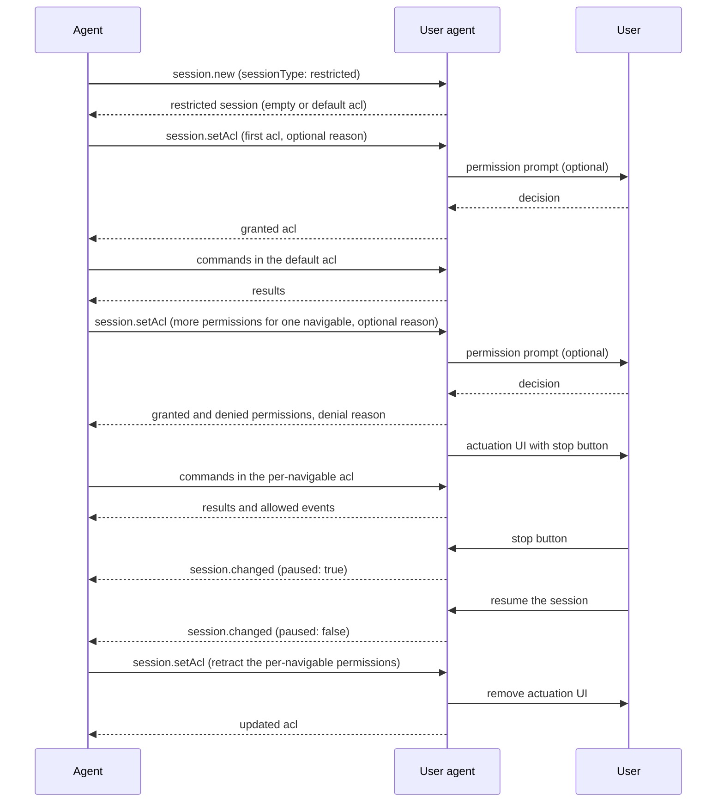

# Restricted sessions

> [!NOTE]
> This document is a part of the [Agentic extensions for WebDriver BiDi](../README.md#introduction) proposal. The proposal is in incubation. All names and data shapes can change.

A restricted session is a WebDriver BiDi session in which the user agent allows only the operations that the user or the user agent granted. This document describes the session model.

Related documents:

- [Commands and events](commands-and-events.md) lists the commands and events that a restricted session supports.
- [Access control lists](acl.md) describes the permissions of a restricted session.
- [Extension transport](extension-transport.md) describes a transport that supports restricted sessions only.

## Terminology

- **User agent**: the browser.
- **Agent**: the WebDriver BiDi client controlled by an AI system.
- **Restricted session**: a WebDriver BiDi session with `sessionType: "restricted"`. The user agent allows only the operations in the ACL of the session.
- **Access control list (ACL)**: a dictionary that contains the allowed origins, commands, and events for a restricted session.
- **Actuation command**: a command that changes the state of a navigable or acts for the user, for example a click, a key press, or a navigation. See [actuation UI](acl.md#actuation-ui).
- **Actuated navigable**: a navigable whose `perNavigable` entry in the effective ACL contains at least one actuation command.

## `session.new`

A client includes `sessionType: "restricted"` in the capabilities of `session.new` to start a restricted session. The result confirms the session type.

`session.new` does not accept an ACL. A restricted session starts with an empty ACL (or only user-agent-default permissions). The agent sends [`session.setAcl`](acl.md#sessionsetacl) to request permissions and receive the effective ACL before using other commands or receiving other events.

User agents must not rely solely on the client passing `sessionType: "restricted"` in `session.new` to enforce restrictions, because a client could omit it and obtain a standard (unrestricted) session. Agent-facing transports and endpoints should allow only restricted sessions (for example, the [extension transport](extension-transport.md#browserdriverconnect)).

Request:

```json
{
  "id": 1,
  "method": "session.new",
  "params": {
    "capabilities": {
      "alwaysMatch": {
        "sessionType": "restricted"
      }
    }
  }
}
```

Response:

```json
{
  "id": 1,
  "type": "success",
  "result": {
    "sessionId": "3f1c6a52-9f0e-4a57-8a0b-6d1e2c7b9a10",
    "capabilities": {
      "sessionType": "restricted"
    }
  }
}
```

## `session.changed`

The user agent sends this event when the user or the user agent changes the session. There are two causes:

- The user pauses or resumes the session. For example, the user clicks the stop button in the [actuation UI](acl.md#actuation-ui).
- The user changes the permissions. For example, the user revokes access to a navigable.

The event has three fields:

- `acl`: the updated ACL.
- `paused`: `true` if the user or the user agent paused the session.
- `reason`: an optional text from the user agent that explains the change, for example why it revoked a permission.

While the session is in the paused state, the agent must expect commands to fail. The connection stays open. See [#35](https://github.com/WICG/agentic-webdriver-bidi/issues/35) for pause semantics and [#30](https://github.com/WICG/agentic-webdriver-bidi/issues/30) for error codes.

The user agent always sends `session.changed` to a restricted session. The ACL does not control this event.

In this example, the user pauses the session and revokes the permissions for navigable `A1B2C3`:

```json
{
  "type": "event",
  "method": "session.changed",
  "params": {
    "paused": true,
    "reason": "The user paused the session and revoked access to the tab.",
    "acl": {
      "default": {
        "origins": ["https://shop.example"],
        "commands": [
          "browsingContext.getTree",
          "browsingContext.captureScreenshot"
        ],
        "events": ["browsingContext.navigationCommitted"]
      },
      "perNavigable": {}
    }
  }
}
```

## Example: a full session

This sequence shows the expected permission flow for one task.



## How this solution addresses the use cases

| Use case | Mechanism |
| :--- | :--- |
| 1. Only allowed operations | A restricted session allows only operations in its effective ACL (initially empty or user-agent defaults). The user agent enforces the `origins`, `commands`, and `events` lists of the ACL. |
| 2. User interrupts the session | `session.changed` with `paused: true`. |
| 3. User revokes permissions | `session.changed` with the updated `acl`. The connection stays open. |
| 4. Agent requests more capabilities | `session.setAcl` with an optional `reason`. The result contains the granted and denied permissions, and an optional reason for the denial. |
| 5. User sees which navigables the agent can actuate | The user agent shows actuation UI for each navigable whose `perNavigable` entry contains an actuation command. Actuation commands are valid only in `perNavigable` entries. Observation commands do not cause actuation UI. |
| 6. User stops the agent | The stop button pauses the session. The agent receives `session.changed` with `paused: true`. |

## Detailed design discussion

### Permissions are part of the protocol

An out-of-band permission mechanism is not interoperable. The agent also cannot react to it. Thus the protocol contains the request (`session.setAcl`), the result, and the change notification (`session.changed`). Each user agent selects how to make the decision. For example, it can use a user prompt, an enterprise policy, or its own analysis of the `reason` (if provided).

### Session type in `session.new`, permissions in `session.setAcl`

`session.new` only selects the restricted mode. All permission requests use `session.setAcl`. This design has these advantages:

- There is one code path for permission requests, results, and denials.
- Each permission request can include a `reason` and occurs near the time of use.
- Session creation does not wait for a user decision.
- Capability matching in `session.new` does not need rules for a partial grant.

The cost is one more command before the agent can do its first operation.

## Considered alternatives

### Session type with permissions outside the protocol

The [original proposal](https://github.com/WICG/proposals/issues/320) also used a session type, `sessionType: "agent"`, and the session started with lifecycle commands only. That proposal did not specify how the agent gets more permissions. This document adds `session.setAcl` and `session.changed` for that purpose.

The user agent could manage all permissions in its own UI, with no protocol surface. Then the agent cannot request permissions, give a reason, or learn about a denial. The behavior is also different in each browser.

## Security and privacy considerations

- **Least privilege.** A restricted session starts with no permissions beyond user-agent defaults. It can use only the origins, commands, and events in its effective ACL. Standard WebDriver BiDi gives full access to the browser.
- **No bypass via `session.new`.** User agents must not rely solely on the client requesting `sessionType: "restricted"` in `session.new`, because a client could omit it to obtain a standard (unrestricted) session. Agent-facing transports and endpoints should allow only restricted sessions (see [`session.new`](#sessionnew) and the [extension transport](extension-transport.md#browserdriverconnect)).
- **Enforcement in the user agent.** The user agent enforces the ACL. The agent and its client library are not trusted to do this.
- **Origin gating.** The agent cannot send commands to, or receive events from, documents of origins that the ACL does not contain.
- **User control.** The user can pause the session or revoke permissions at any time. The effect is immediate.
- **Visible actuation.** The agent can actuate a navigable only if the `perNavigable` entry for that navigable contains actuation commands. Thus the user agent knows all navigables that the agent can actuate, and can show this to the user. If an agent keeps its permissions longer than necessary, the user agent shows the actuation UI for longer, not shorter.
- **Limits.** Protocol permissions do not prevent all unwanted actions. An agent with permission to click can do a destructive action on an allowed origin.
- **Sub-task isolation.** The user agent cannot distinguish an agent harness from the model, and one session cannot control another session's ACL, so limiting sub-tasks (for example, a planner versus sub-agents) is the client's responsibility.
- **Reason text from the agent.** The `reason` in `session.setAcl` comes from the agent and is not trusted. The user agent must not show it as a statement of fact.
- **Reason text from the user agent.** A denial reason can disclose information about the user or a policy. The user agent selects the content and can omit the reason.
- **Enterprise policy blocklists.** The protocol does not disclose the full blocklist of the user agent. The ACL contains only allowed items, and the `denied` field contains only items that the agent requested. `browsingContext.getTree` omits blocked origins and origins that are not in the ACL in the same way. But an agent can name many items in one `session.setAcl` call and learn from `denied` which of them are blocked. The user agent can limit this, for example with generic denial reasons, limits on request size, or rate limits.
