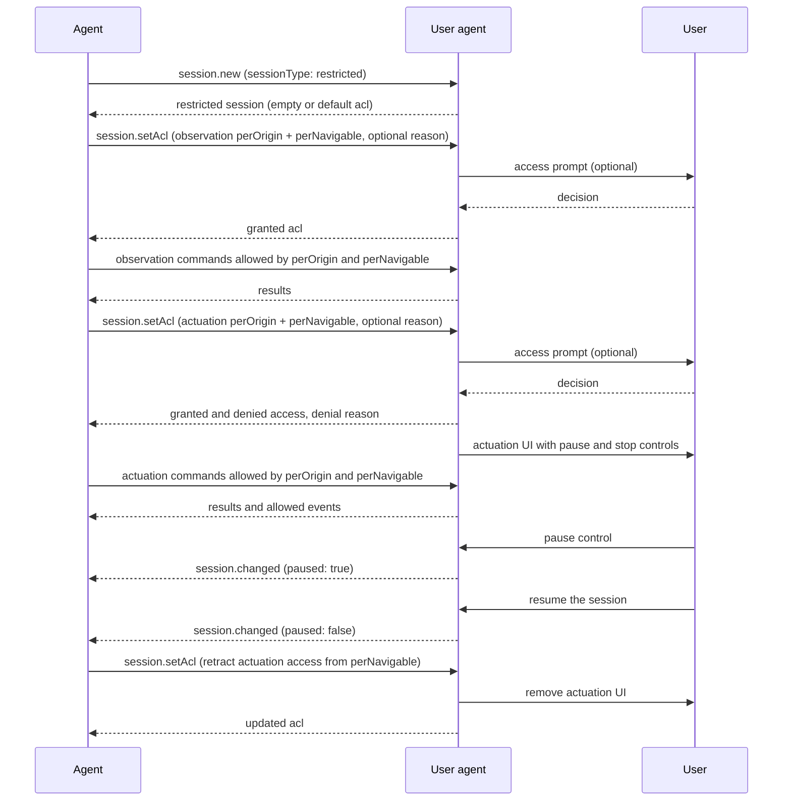

# Restricted sessions

> [!NOTE]
> This document is a part of the [Agentic extensions for WebDriver BiDi](../README.md#introduction) proposal. The proposal is in incubation. All names and data shapes can change.

A restricted session is a WebDriver BiDi session in which the user agent allows only the operations that the user or the user agent granted. This document describes the session model.

Related documents:

- [Use cases](use-cases.md) describes the user tasks that this proposal supports.
- [Security model](security-model.md) describes the security principles and required configuration capabilities.
- [Commands and events](commands-and-events.md) lists the commands and events that a restricted session supports.
- [Access control lists](acl.md) describes the access of a restricted session.
- [Extension transport](extension-transport.md) describes a transport that supports restricted sessions only.

## Terminology

- **User agent**: the browser.
- **Agent**: the WebDriver BiDi client controlled by an AI system.
- **Restricted session**: a WebDriver BiDi session with `sessionType: "restricted"`. The user agent allows only the operations in the ACL of the session.
- **Access control list (ACL)**: a dictionary with `default`, `perOrigin`, and `perNavigable` entries that defines the allowed commands and events for a restricted session.
- **Actuation command**: a command that changes the state of a navigable or acts for the user, for example a click, a key press, or a navigation. See [actuation UI](acl.md#actuation-ui).
- **Actuated navigable**: a navigable whose `perNavigable` entry in the effective ACL contains at least one actuation command.

## `session.new`

A client includes `sessionType: "restricted"` in the capabilities of `session.new` to start a restricted session. The result confirms the session type.

`session.new` does not accept an ACL. A restricted session starts with an empty ACL (or only user-agent-default access). The agent sends [`session.setAcl`](acl.md#sessionsetacl) to request access and receive the effective ACL before using other commands or receiving other events.

User agents must not rely solely on the client passing `sessionType: "restricted"` in `session.new` to enforce restrictions, because a client could omit it and obtain a standard (unrestricted) session. Agent-facing transports and endpoints should allow only restricted sessions (for example, the [extension transport](extension-transport.md#browserdriverconnect)).

Request:

```json
{
  "id": 1,
  "method": "session.new",
  "params": {
    "capabilities": {
      "alwaysMatch": {
        "sessionType": "restricted"
      }
    }
  }
}
```

Response:

```json
{
  "id": 1,
  "type": "success",
  "result": {
    "sessionId": "3f1c6a52-9f0e-4a57-8a0b-6d1e2c7b9a10",
    "capabilities": {
      "sessionType": "restricted"
    }
  }
}
```

## `session.changed`

The user agent sends this event when the user or the user agent changes the session. There are two causes:

- The user pauses or resumes the session ([U2](use-cases.md#u2-the-user-interrupts-the-agent-and-changes-the-page)). For example, the user clicks the pause control in the [actuation UI](acl.md#actuation-ui).
- The user or the user agent changes the access. For example, the user revokes access to a navigable or origin ([U3](use-cases.md#u3-the-user-revokes-access-during-the-task)), or adds a specific tab to the session ([U7](use-cases.md#u7-the-user-adds-a-specific-tab-to-the-agent-session)).

The event has three fields:

- `acl`: the updated ACL.
- `paused`: `true` if the user or the user agent paused the session.
- `reason`: an optional text from the user agent that explains the change, for example why it revoked access.

While the session is in the paused state, the agent must expect commands to fail. The connection stays open. See [#35](https://github.com/WICG/agentic-webdriver-bidi/issues/35) for pause semantics and [#30](https://github.com/WICG/agentic-webdriver-bidi/issues/30) for error codes.

Terminating the session ([U6](use-cases.md#u6-the-user-terminates-the-agent-session-with-one-action)) is different from pausing. When the user activates the stop control, the user agent terminates the session immediately and revokes all access, including inflight requests whenever possible. A new session starts with no access beyond user-agent defaults.

The user agent always sends `session.changed` to a restricted session. The ACL does not control this event.

In this example, the user pauses the session and revokes access to navigable `A1B2C3`:

```json
{
  "type": "event",
  "method": "session.changed",
  "params": {
    "paused": true,
    "reason": "The user paused the session and revoked access to the tab.",
    "acl": {
      "default": {
        "commands": [],
        "events": []
      },
      "perOrigin": {
        "https://shop.example": {
          "commands": [
            "browsingContext.getTree",
            "browsingContext.captureScreenshot"
          ],
          "events": ["browsingContext.navigationCommitted"]
        }
      },
      "perNavigable": {}
    }
  }
}
```

## Example: a full session

This sequence shows the expected access control flow for one task.



## How this solution addresses the use cases

| Use case | Mechanism |
| :--- | :--- |
| [U1. Only needed access](use-cases.md#u1-the-agent-uses-only-the-access-that-the-task-needs) | A restricted session starts with no access beyond user-agent defaults. The agent requests `perOrigin` and `perNavigable` entries via `session.setAcl` with a `reason` and retracts them after the task. The user agent enforces both maps. |
| [U2. User interrupts and changes the page](use-cases.md#u2-the-user-interrupts-the-agent-and-changes-the-page) | The user pauses the session; the user agent sends `session.changed` with `paused: true` and blocks commands. When the user resumes, the user agent sends `session.changed` with `paused: false`. |
| [U3. User revokes access during the task](use-cases.md#u3-the-user-revokes-access-during-the-task) | The user revokes a tab or origin; the user agent sends `session.changed` with the updated `perOrigin` and `perNavigable` entries immediately and keeps the connection open. |
| [U4. Task needs more access](use-cases.md#u4-the-task-needs-more-access-than-the-agent-has) | The agent calls `session.setAcl` with a `reason` to add a new `perNavigable` entry ([U4.1](use-cases.md#u41-the-task-needs-access-to-a-new-tab-on-an-allowed-site)) or a new `perOrigin` entry ([U4.2](use-cases.md#u42-the-task-needs-access-to-a-new-site-in-the-same-tab)). The result contains the effective `acl`, any `denied` entries, and an optional denial `reason`. |
| [U5. Read one tab, act in another](use-cases.md#u5-the-agent-reads-one-tab-and-acts-in-a-different-tab) | `perOrigin` and `perNavigable` allow observation commands for the read-only tab and origin, and actuation commands for the target tab and origin. The user agent shows actuation UI only for navigables whose `perNavigable` entry contains an actuation command. |
| [U6. User terminates the session with one action](use-cases.md#u6-the-user-terminates-the-agent-session-with-one-action) | The stop control terminates the session immediately and revokes all access, including inflight requests whenever possible. A new session starts with no access beyond user-agent defaults. |
| [U7. User adds a specific tab to the session](use-cases.md#u7-the-user-adds-a-specific-tab-to-the-agent-session) | The user grants access to a tab in the user agent UI. The user agent sends `session.changed` with the updated `perOrigin` and `perNavigable` entries. |
| [U8. User confirms form submission](use-cases.md#u8-the-user-confirms-the-submission-of-a-form-that-the-agent-filled-out) | `perOrigin` and `perNavigable` scope input access to the form's origin and tab. The agent requests user confirmation in its UI before sending the submit input command. |
| [U9. User completes part of a task manually](use-cases.md#u9-the-user-completes-part-of-a-task-manually-instead-of-granting-access) | The user denies the `perOrigin` request for `pay.example` and pauses the session (`session.changed` with `paused: true`). After manual payment returns to `shop.example`, the user resumes the session (`paused: false`). |

## Detailed design discussion

### Access control is part of the protocol

An out-of-band access control mechanism is not interoperable. The agent also cannot react to it. Thus the protocol contains the request (`session.setAcl`), the result, and the change notification (`session.changed`). Each user agent selects how to make the decision. For example, it can use a user prompt, an enterprise policy, or its own analysis of the `reason` (if provided).

### Session type in `session.new`, access requests in `session.setAcl`

`session.new` only selects the restricted mode. All access requests use `session.setAcl`. This design has these advantages:

- There is one code path for access requests, results, and denials.
- Each access request can include a `reason` and occurs near the time of use.
- Session creation does not wait for a user decision.
- Capability matching in `session.new` does not need rules for a partial grant.

The cost is one more command before the agent can do its first operation.

## Considered alternatives

### Session type with access control outside the protocol

The [original proposal](https://github.com/WICG/proposals/issues/320) also used a session type, `sessionType: "agent"`, and the session started with lifecycle commands only. That proposal did not specify how the agent gets more access. This document adds `session.setAcl` and `session.changed` for that purpose.

The user agent could manage all access control in its own UI, with no protocol surface. Then the agent cannot request access, give a reason, or learn about a denial. The behavior is also different in each browser.

## Security and privacy considerations

See [Security model](security-model.md) for the full set of principles and required configuration capabilities.

- **Least privilege.** A restricted session starts with no access beyond user-agent defaults. A navigable command or event succeeds only if both `perOrigin` and `perNavigable` in the effective ACL allow it. Standard WebDriver BiDi gives full access to the browser.
- **No bypass via `session.new`.** User agents must not rely solely on the client requesting `sessionType: "restricted"` in `session.new`, because a client could omit it to obtain a standard (unrestricted) session. Agent-facing transports and endpoints should allow only restricted sessions (see [`session.new`](#sessionnew) and the [extension transport](extension-transport.md#browserdriverconnect)).
- **Enforcement in the user agent.** The user agent enforces the ACL. The agent and its client library are not trusted to do this.
- **Origin and navigable gating.** The user agent blocks observations, actuations, tab takeovers, and navigations (including redirects) for origins that `perOrigin` does not allow, including cross-origin iframes. It also blocks access to navigables that `perNavigable` does not allow.
- **Shared data boundary across controlled tabs.** All controlled tabs share the agent context window. Therefore, `perNavigable` limits which commands and events the agent can run in each tab, rather than isolating data between controlled tabs.
- **User control.** The user can pause the session, revoke access, or terminate the session at any time. The effect is immediate.
- **Visible actuation.** The agent can actuate a navigable only if both its `perNavigable` entry and the target document's `perOrigin` entry contain actuation commands. Thus the user agent knows all navigables that the agent can actuate, and can show this to the user. If an agent keeps its access longer than necessary, the user agent shows the actuation UI for longer, not shorter.
- **Limits.** Protocol access control does not prevent all unwanted actions. An agent with access to a click command can do a destructive action on an allowed origin.
- **Sub-task isolation.** The user agent cannot distinguish an agent harness from the model, and one session cannot control another session's ACL, so limiting sub-tasks (for example, a planner versus sub-agents) is the client's responsibility.
- **Reason text from the agent.** The `reason` in `session.setAcl` comes from the agent and is not trusted. The user agent must not show it as a statement of fact.
- **Reason text from the user agent.** A denial reason can disclose information about the user or a policy. The user agent selects the content and can omit the reason.
- **Enterprise policy blocklists.** The protocol does not disclose the full blocklist of the user agent. The ACL contains only allowed items, and the `denied` field contains only items that the agent requested. `browsingContext.getTree` omits blocked origins and origins that are not in the ACL in the same way. But an agent can name many items in one `session.setAcl` call and learn from `denied` which of them are blocked. The user agent can limit this, for example with generic denial reasons, limits on request size, or rate limits.
